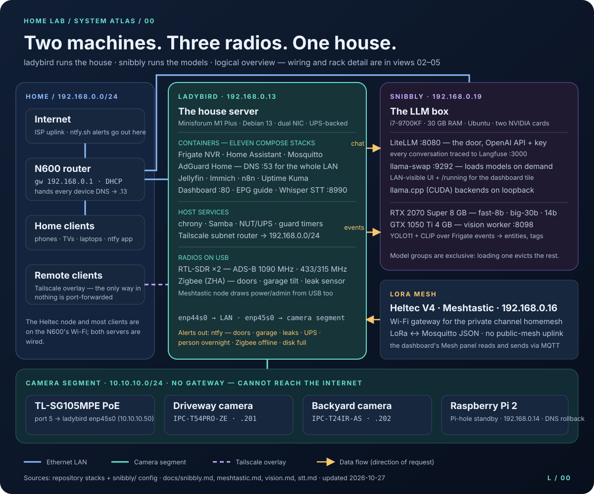
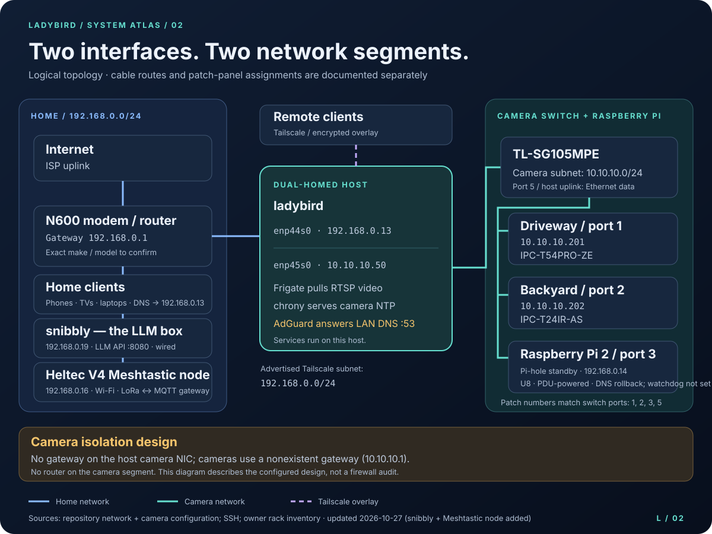

# The home lab — `ladybird`, `snibbly` and the radios

Two machines run the house. **ladybird**, a mini PC in the rack, runs the security cameras, the
movie library, the photo library, the home automation, and the DNS for every device in the house.
**snibbly**, a GPU desktop, serves local LLMs to the LAN and gives the cameras a second, smarter
look. Around them: a Zigbee network of door and leak sensors, two software-defined radios, and a
LoRa mesh node.

**This repository is the blueprint for all of it** — every configuration file needed to rebuild
both machines from a blank install, minus the passwords. Nothing here is running code; it is the
plan for what runs.

---

## What it does

| | |
|---|---|
| 📹 **Watches the house** | Two PoE cameras record continuously and flag people and cars, using ladybird's built-in GPU. The cameras sit on their own cable network with no route to the internet. |
| 👀 **Looks twice** | A second-stage vision pipeline on snibbly's spare GPU re-analyzes camera events — detection, embeddings, recurring-entity clustering, tags ([vision.md](docs/vision.md)). |
| 🧠 **Serves the LLMs** | snibbly loads Qwen3 models on demand behind one OpenAI-compatible door, with every conversation traced to Langfuse ([snibbly.md](docs/snibbly.md), [langfuse.md](docs/langfuse.md)). |
| 🏠 **Runs the automation** | Home Assistant, with the cameras, Zigbee sensors, lights and both servers' health wired into it. |
| 🚨 **Shouts when it matters** | ntfy push alerts: doors left open, garage overnight, water leaks, person overnight, UPS on battery, disk filling, Zigbee sensors going quiet. |
| 🎙 **Listens** | The dashboard's mic goes through whisper.cpp on ladybird to the assistant ([stt.md](docs/stt.md)). |
| 🍿 **Serves the media** | Jellyfin for films and TV, with a live-TV guide rebuilt nightly. |
| 🖼️ **Keeps the photos** | Immich — a self-hosted photo library that replaces the cloud one. |
| 🛡️ **Filters the ads** | AdGuard Home answers DNS for the whole house, so ads are gone on every device without installing anything on them. |
| ✈️ **Tracks the planes** | An RTL-SDR radio decodes ADS-B and draws a live aircraft map; a second dongle decodes 433/315 MHz sensors ([sdr.md](docs/sdr.md)). |
| 📟 **Meshes off-grid** | A Heltec LoRa node bridges a private Meshtastic channel onto MQTT and the dashboard ([meshtastic.md](docs/meshtastic.md)). |
| 🩺 **Watches itself** | Uptime Kuma, a UPS that shuts ladybird down cleanly, and small guards that shout if the disk fills or the power fails. |

## Where to click

Everything is on the home network only. Nothing is port-forwarded; from outside the house you come
in over Tailscale.

**On ladybird — `192.168.0.13`:**

| | Address | Notes |
|---|---|---|
| **Dashboard** | `http://ladybird/` | the everyday view — custom UI over the Home Assistant API |
| Dashboard (https) | `https://ladybird.tail0e6756.ts.net` | same app via `tailscale serve` — required for the assistant's mic ([stt.md](docs/stt.md)) |
| **Cameras** (Frigate) | `https://192.168.0.13:8971` | login required |
| **Home Assistant** | `http://192.168.0.13:8123` | http, not https — by design |
| **Photos** (Immich) | `http://192.168.0.13:2283` | first account created becomes the admin |
| **Media** (Jellyfin) | `http://192.168.0.13:8096` | |
| **Ad filtering** (AdGuard) | `http://192.168.0.13:8053` | also answers DNS on port 53 for the LAN |
| **Monitoring** (Uptime Kuma) | `http://192.168.0.13:3001` | [setup notes](docs/uptime-kuma.md) |
| **Passwords** (Vaultwarden) | `https://ladybird.tail0e6756.ts.net:8443` | tailnet only, via `tailscale serve` — never log in over the plain-http `:8222` ([vaultwarden.md](docs/vaultwarden.md)) |
| **Automations** (n8n) | `http://192.168.0.13:5678` | |
| **Aircraft map** (tar1090) | `http://192.168.0.13:8080` | [setup notes](docs/sdr.md) |
| **File share** (Samba) | `//192.168.0.13/files` | serves `/srv/storage/files` |
| Speech-to-text (whisper) | `http://192.168.0.13:8990` | used by the dashboard's `/api/stt` |
| Frigate API | `http://192.168.0.13:5000` | **no login** — LAN only, never port-forward |
| MQTT (Mosquitto) | `192.168.0.13:1883` | anonymous, LAN only |
| TV guide (XMLTV) | `http://192.168.0.13:3000/guide.xml` | feeds Jellyfin's live TV |

**On snibbly — `192.168.0.19`:**

| | Address | Notes |
|---|---|---|
| **LLM API** (LiteLLM) | `http://192.168.0.19:8080/v1` | OpenAI-compatible, API key required — the only chat door |
| **LLM traces** (Langfuse) | `http://192.168.0.19:3000` | every conversation, login required ([langfuse.md](docs/langfuse.md)) |
| Model router (llama-swap) | `http://192.168.0.19:9292` | `/ui`, `/running` — same API key, LAN only |
| Vision worker health | `http://192.168.0.19:8098` | queue depth, sweep lag, counters |

## Read this before changing anything

- **DNS for the whole house runs on ladybird.** When this box is down, nothing in the house
  resolves — and it does not look like "the server is down", it looks like the internet is broken,
  on every device at once. The old Pi-hole at `192.168.0.14` is the rollback and stays powered.
  Read [docs/dns.md](docs/dns.md) before touching that stack.
- **The dashboard and the Frigate API have no login.** Anyone who can reach them can use them. Keep
  them on the LAN.
- **Two configs rewrite themselves** — Frigate's and AdGuard's. What is in this repo is the seed,
  not a live copy. Editing them carelessly has a specific way of going wrong; see
  [docs/gotchas.md](docs/gotchas.md).
- **On snibbly, model groups are exclusive.** Loading one evicts the others, and a model calling a
  model in another group deadlocks — see [docs/snibbly.md](docs/snibbly.md) before wiring anything
  agent-like into the LLMs.
- **Ladybird has panicked before.** A frozen box with the lights on is a kernel panic, not a
  network fault. The crash record is in `/var/lib/systemd/pstore/` after the next boot.

## The shape of it

Two physical networks, and ladybird is the only thing on both. The cameras live on their own
segment with **no gateway**, so they cannot reach the internet whatever their firmware would prefer;
ladybird serves them time and pulls their video. Everything else — snibbly, the Meshtastic node,
the family's devices — sits on the home LAN, reachable from outside only through Tailscale.

Six drawings cover the system from different angles — all of them are plain SVG you can open,
zoom and edit:

| Drawing | What it explains |
|---|---|
| [The fleet](docs/diagrams/fleet.svg) | both machines, the radios, and the data flows between them |
| [Inside ladybird](docs/diagrams/architecture.svg) | machine → Debian → containers, GPU access and storage |
| [Network topology](docs/diagrams/network.svg) | home LAN, Tailscale and the camera segment |
| [Rack elevation](docs/diagrams/rack.svg) | what sits in U1–U8, and how it is powered |
| [Camera to dashboard](docs/diagrams/camera-flow.svg) | video in, events through MQTT, alerts out |
| [Wiring and power](docs/diagrams/wiring.svg) | which switch port goes to which patch jack |

Full notes, the hardware inventory and what is still unconfirmed: [system atlas](docs/diagrams/README.md).

## The guides

| If you want to… | Read |
|---|---|
| know how it all fits together | [architecture.md](docs/architecture.md) |
| do something day to day | [operations.md](docs/operations.md) — health checks, common tasks, after a crash |
| rebuild the whole thing | [rebuild.md](docs/rebuild.md) — blank Debian to running, in 14 steps |
| apply configs / check drift | [ansible.md](docs/ansible.md) — the playbooks behind most of those steps |
| avoid a trap someone already hit | [gotchas.md](docs/gotchas.md) |
| know what is *not* done | [known-gaps.md](docs/known-gaps.md) |
| add or reconfigure a camera | [cameras.md](docs/cameras.md) |
| touch DNS | [dns.md](docs/dns.md) |
| touch the radio | [sdr.md](docs/sdr.md) |
| change what is monitored | [uptime-kuma.md](docs/uptime-kuma.md) |
| store, back up or rotate a secret | [vaultwarden.md](docs/vaultwarden.md) — the password vault |
| touch the LLM box | [snibbly.md](docs/snibbly.md) — models, groups, the agent runner |
| see what the LLMs are being asked | [langfuse.md](docs/langfuse.md) — trace capture on snibbly |
| the camera vision pipeline on snibbly | [vision.md](docs/vision.md) |
| voice input for the assistant | [stt.md](docs/stt.md) |
| the LoRa mesh node | [meshtastic.md](docs/meshtastic.md) |

## The machines

| | `ladybird` | `snibbly` |
|---|---|---|
| Role | the house server | the LLM box |
| Hardware | Minisforum M1 Plus — i5-12600H (12C/16T), Iris Xe, 16 GB, 512 GB NVMe, dual 2.5GbE | desktop — i7-9700KF, 30 GB, RTX 2070 Super 8 GB + GTX 1050 Ti 4 GB |
| OS | Debian 13 (Trixie), bare metal | Ubuntu, bare metal |
| Address | `192.168.0.13` | `192.168.0.19` |
| Config in repo | `stacks/` (Compose, → `/opt/stacks`) and `host/` (→ `/etc`) | `snibbly/` (systemd units, `/etc` files, the vision worker, one Compose stack) |

Exact ladybird image versions at the last capture are in [VERSIONS.txt](VERSIONS.txt). Passwords
and tokens are never in this repo — the list of what to recreate by hand is at the end of
[rebuild.md](docs/rebuild.md#secrets--not-in-this-repo) and in each machine's guide.
