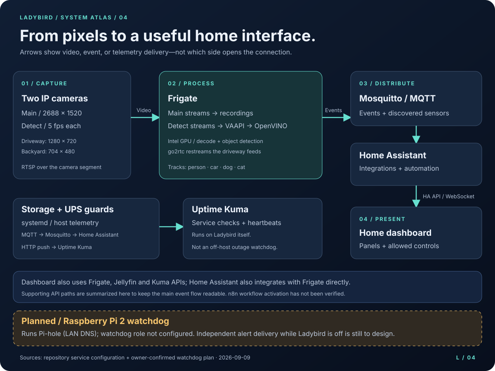

# How ladybird is put together

The design decisions behind the running system, and why they are the way they are. For the
picture-book version see the [system atlas](diagrams/README.md); for rebuilding it, see
[rebuild.md](rebuild.md). This guide covers **ladybird** and how the other boxes hang off it;
the LLM box has its own guide ([snibbly.md](snibbly.md)), and the multi-machine picture is the
atlas's [fleet view](diagrams/fleet.svg).

---

## The machine

| | |
|---|---|
| Hardware | Minisforum M1 Plus — i5-12600H (12C/16T), Iris Xe 80EU, 16 GB DDR5, 512 GB NVMe, dual 2.5GbE |
| OS | Debian 13 (Trixie), kernel 6.12 — bare metal, no hypervisor |
| Hostname / LAN | `ladybird` · `192.168.0.13` (DHCP, reserved for MAC `38:05:25:35:71:69`) |
| Everything runs as | Docker Compose stacks in `/opt/stacks`, plus a handful of host services |
| Exact image digests | [VERSIONS.txt](../VERSIONS.txt) |

One disk. `/srv/storage` (recordings, media, photos, file share) and `/opt/stacks` (config and app
state) share the root ext4 filesystem, deliberately: the planned second drive becomes a remount
rather than a reconfiguration.

---

## Two networks, one host

Two *physical* networks, and the server is the only thing on both.


- **Home LAN — `192.168.0.0/24`**, on `enp44s0`. The N600 router connects directly to this NIC.
- **Camera segment — `10.10.10.0/24`**, on `enp45s0`, through patch 5 to port 5 of the PoE switch.

The cameras have **no gateway**, so they cannot reach the internet no matter what their firmware
would like to do. Turning off P2P, UPnP and DDNS in the camera UI is policy; the missing route is
enforcement. The server serves those cameras NTP via chrony and pulls their RTSP streams — nothing
else crosses.

A **Raspberry Pi 2** sits on the same shelf and used to be the LAN's DNS resolver (Pi-hole at
`192.168.0.14`). Since the AdGuard cutover it is the rollback, not the live resolver, and it is not
managed by this repo. Its intended second job — watching ladybird from outside ladybird — is still
not configured; see [planned Pi watchdog](diagrams/README.md#planned-pi-watchdog).

Remote access is **Tailscale**, as a subnet router advertising `192.168.0.0/24`. Nothing here is
port-forwarded, and Frigate in particular never should be.

---

## DNS is load-bearing

AdGuard Home in the `dns` stack answers DNS for **every device in the house**, handed out by the
router over DHCP. That makes ladybird load-bearing for people who have never heard of it: when this
box is down, nothing in the house resolves, and it does not look like "the server is down" — it
looks like the internet is broken, on every device at once.

Consequences worth internalising:

- Reboots of this box are everyone's reboots. It has a kernel-panic history.
- Do DNS maintenance from a device pinned to a different resolver.
- The DHCP reservation for `192.168.0.13` is now mandatory, not tidy-up.
- The Pi-hole at `192.168.0.14` stays powered as the two-minute rollback.

Read [dns.md](dns.md) before restarting anything in that stack.

---

## Cameras and detection



Object detection runs on the Intel iGPU via OpenVINO (`ssdlite_mobilenet_v2`) at roughly 10 ms per
inference; Frigate decodes with VAAPI. Streams are split by job, because detecting on a 4MP stream
is a waste and recording a 704×480 one is a regret:

| Camera | Detect stream | Record stream |
|---|---|---|
| Driveway (IPC-T54PRO-ZE) | 1280×720 @ 5 fps — its third stream, `subtype=2` | 2688×1520 main |
| Backyard (IPC-T24IR-AS) | 704×480 @ 5 fps | 2688×1520 main |

The driveway streams also go through go2rtc, so the live view in the UI can show either the full
4MP main stream or the 720p sub stream.

Provisioning, white-light control and the Dahua API quirks are in [cameras.md](cameras.md).

Frigate is the real-time stage, not the only stage: a second-stage pipeline on **snibbly** subscribes
to `frigate/events` on Mosquitto, pulls event clips from the Frigate API, and runs deeper detection,
embeddings and recurring-entity clustering on its spare GPU. See [vision.md](vision.md).

### Retention

Tiered, so the expensive tier is short and the cheap tier is long:

| Tier | Window | Mode |
|---|---|---|
| Continuous | 2 days | everything |
| Detections | 7 days | motion only |
| Alerts | 14 days | motion only |
| Snapshots | 60 days (person 180, car 90) | JPEG, negligible size |

There is no GB quota — retention is days-only. See [known-gaps.md](known-gaps.md).

---

## Zigbee sensors and the alert tree

A Zigbee coordinator on ladybird's USB, managed by **ZHA inside Home Assistant** (configured through
the UI, so there is little yaml to track). On the network: two door sensors (front door, sun-room
sliding door), a garage-door tilt sensor, and a sink water-leak sensor. The automations in
[stacks/home/homeassistant/automations.yaml](../stacks/home/homeassistant/automations.yaml) turn
them — plus the cameras — into **ntfy push alerts**: doors left open (escalating, urgent overnight),
garage door open (tiered by time of day), water leak, person detected overnight, and an availability
tier (any sensor offline 30 minutes; all four down at once reads as the coordinator being down).
The ntfy topic URL is a secret — it lives in `secrets.yaml` on the server, never in git.

## Mesh radio

An ESP32 Meshtastic node (Heltec V4, `192.168.0.16`) on the house Wi‑Fi gateways a private LoRa
channel onto the Mosquitto broker in the `home` stack — decoded JSON in both directions, no
public-mesh uplink. The dashboard subscribes and renders the channel (messages, node roster, a send
box). The node is hardware, not a container; the `mesh/` stack is only a profile-gated CLI wrapper
for administering it. Its runbook is [meshtastic.md](meshtastic.md).

## Voice

The dashboard's mic button records in the browser, posts to the dashboard's `/api/stt`, which
forwards to **whisper.cpp** in the `stt` stack (`:8990`, `small.en` model, CPU). The transcript goes
into the same assistant chat path as typed text — which is served by snibbly's LLM door. Browsers
only allow mic capture on HTTPS, which is why the dashboard also has a `tailscale serve` front at
`https://ladybird.tail0e6756.ts.net`. See [stt.md](stt.md).

## The second machine

**snibbly** (`192.168.0.19`) serves local LLMs to the LAN: LiteLLM on `:8080` is the only chat door
(OpenAI API + key), tracing every conversation to Langfuse (`:3000`) and forwarding to llama-swap,
which starts and stops llama.cpp model backends on demand on the RTX 2070 Super. The GTX 1050 Ti is
carved out for the camera vision pipeline. Ladybird and snibbly meet in four places: the dashboard's
assistant chat calls the LLM door, the vision worker consumes Frigate's MQTT events and clips,
Uptime Kuma on ladybird monitors snibbly's services, and nothing else crosses. Details:
[snibbly.md](snibbly.md), [langfuse.md](langfuse.md), [vision.md](vision.md).

---

## Watching itself

Three layers, arranged so that a failure is noticed by *absence* rather than by someone happening to
look:

1. **Uptime Kuma** (`:3001`) polls every service and hosts the push monitors.
2. **systemd guards** — `disk-guard`, `ups-guard`, `frigate-guard`, `kuma-watchdog` — run on timers,
   publish to MQTT for Home Assistant, and beat a Kuma push monitor *only while healthy*. A dead
   guard therefore alerts by going quiet.
3. **NUT** talks to the CyberPower UPS over USB and halts the box cleanly on low battery.

The gap: Kuma runs on the machine it is watching, so it cannot alert after the whole host stops.
That is the Pi's unfinished job.

---

## Where the files live

```
stacks/          -> deploys to /opt/stacks on the server
  dash/          the custom dashboard (image built from the home-dashboard repo)
  dns/           AdGuard Home: LAN DNS + ad filtering (AdGuardHome.yaml is the seed config)
  frigate/       docker-compose.yml + config/config.yml
  home/          Home Assistant + Mosquitto
  immich/        Immich photo library
  media/         Jellyfin + the iptv-org EPG grabber (epg/channels.xml is its channel list)
  mesh/          Meshtastic CLI wrapper (profile-gated; the node itself is hardware - docs/meshtastic.md)
  n8n/           workflow automation + workflow definitions
  net/           Uptime Kuma, the storage/UPS/Frigate guards, the IPTV playlist builder
                 (kuma-monitors.yml defines the monitor set)
  sdr/           RTL-SDR: ADS-B decoding, tar1090 map, adsb.fi/adsb.lol feeding, rtl_433
  stt/           whisper.cpp speech-to-text server for the assistant's mic (docs/stt.md)
host/etc/        -> deploys to /etc on the server
host/snippets/   fragments to append to existing system files
host/scripts/    one-shot host setup scripts (run with sudo on the server)
snibbly/         -> the LLM box's mirror of the same idea (docs/snibbly.md)
  etc/           systemd units + /etc config: llama-swap, litellm, vision, sysctl
  stacks/        its one Compose stack: Langfuse (docs/langfuse.md)
  vision/        the vision worker + analyzer (docs/vision.md)
  agent-runner/  the two-tier agent runner (docs/snibbly.md)
docs/            these guides
  diagrams/      system atlas: editable SVG diagrams, rack inventory and evidence notes
```

Two configs rewrite themselves on the server — Frigate's `config.yml` and AdGuard's
`AdGuardHome.yaml`. What is tracked here is the seed; pulling live changes back is a manual,
careful job. See [gotchas.md](gotchas.md).
