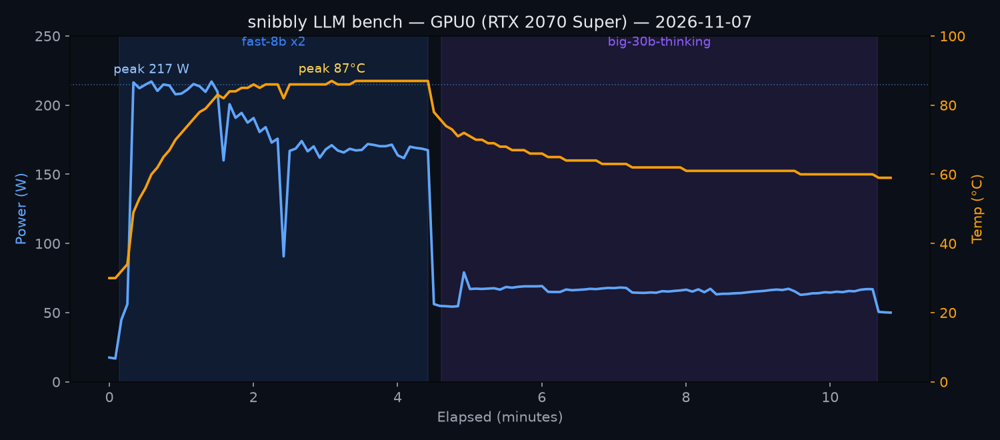

# snibbly LLM bench — 2026-11-07

Post-fix validation run after setting RAM to JEDEC DDR4-2666 in BIOS (was XMP
3600 MT/s, the suspected cause of the load-correlated hard freezes — see the
`snibbly-lockups` history). This run is the "did the fix hold" evidence.

**Verdict: PASS.** ~10.5 minutes of sustained LLM load, 0 errors, GPU driven to
full TDP (217 W) and 87 °C with no freeze, no MCE/EDAC errors. The previous
freeze (#5) died in under 60 s at a mere 46 W power ramp.

## Setup

- Host: snibbly (192.168.0.19), i7-9700KF, 2×16 GB DDR4 **@ 2667 MT/s** (dmidecode-confirmed), RTX 2070 Super 8 GB (GPU0) + GTX 1050 Ti 4 GB (GPU1, idle).
- Driver path: client → litellm `:8080` → llama-swap → llama.cpp (CUDA).
- Tool: `bench_llm.py` (stdlib-only concurrent generation driver).
- Telemetry: `nvidia-smi -l 5` → `raw/gpu_telemetry_2026-11-07.csv` (5 s samples).

## Throughput

| Phase | Model | Concurrency | Duration | Requests | Tokens | Errors | Aggregate |
|---|---|---|---|---|---|---|---|
| 1 | fast-8b (Qwen3-8B Q4) | 2 | 257 s | 30 | 30,720 | 0 | 119.4 tok/s |
| 2 | big-30b-thinking (Qwen3-30B-A3B Q4) | 1 | 363 s | 5 | 10,240 | 0 | 28.2 tok/s |

Per-stream steady state: fast-8b ~59–64 tok/s each (two streams); big-30b
~29.7 tok/s. First request in each phase is slower (cold cache / model load):
45.8 tok/s and 23.5 tok/s respectively.

## Prefill vs decode (server timings @ 1609-token prompt, 300 output)

Measured directly from llama-server's `timings` object (the concurrent bench
above only captured end-to-end wall-clock; these are the clean per-stage rates).

| Model | Prefill (prompt) | Decode (generation) | Prefill ÷ decode |
|---|---|---|---|
| fast-8b (dense, all on GPU) | **1851 tok/s** (0.54 ms/tok) | **68.8 tok/s** (14.5 ms/tok) | 27× |
| big-30b-thinking (MoE, experts in RAM) | **621 tok/s** (1.61 ms/tok) | **29.2 tok/s** (34.3 ms/tok) | 21× |

- 8B vs 30B: ~3× faster prefill, ~2.4× faster decode.
- Prefill is 20–27× faster than decode (prompt tokens process in parallel;
  generation is sequential, one token at a time).
- **Cold time-to-first-token at full 64k context** (prefill only): ~35 s on 8B,
  ~103 s on the 30B. This is why prefix caching + a resident model (`ttl: 0`)
  are non-negotiable for the agent harness — steady-state turns only prefill the
  *new* tokens, not the whole history.

## GPU0 telemetry



Note the shape: fast-8b (fully GPU-resident) **saturates** the card at ~217 W /
87 °C — it's GPU-bound. The 30B MoE drops to ~65 W / 60 °C because its experts
run on CPU/RAM, so the GPU spends most cycles *waiting* — it's CPU/RAM-bound.
The big agent model therefore runs cool but slow, and leaves GPU headroom.

- **Idle:** 16.9 W — this is the regime freeze #5 died in (17→46 W ramp).
- **Peak power:** 217 W — essentially the card's full TDP, sustained in phase 2.
- **Peak temp:** 87 °C — safe for a 2070S but worth watching airflow if the box
  takes on continuous agent duty.
- **VRAM:** 7664 MiB resident (the 30B's attention/KV; experts offloaded to RAM).

Regenerate the chart after a new run:

```
python plot_telemetry.py raw/<new>.csv gpu_power_temp.svg
```

## Reproduce

```
LLAMA_API_KEY=... python3 bench_llm.py --model fast-8b --concurrency 2 --duration 240
LLAMA_API_KEY=... python3 bench_llm.py --model big-30b-thinking --concurrency 1 --duration 360 --max-tokens 2048
```
